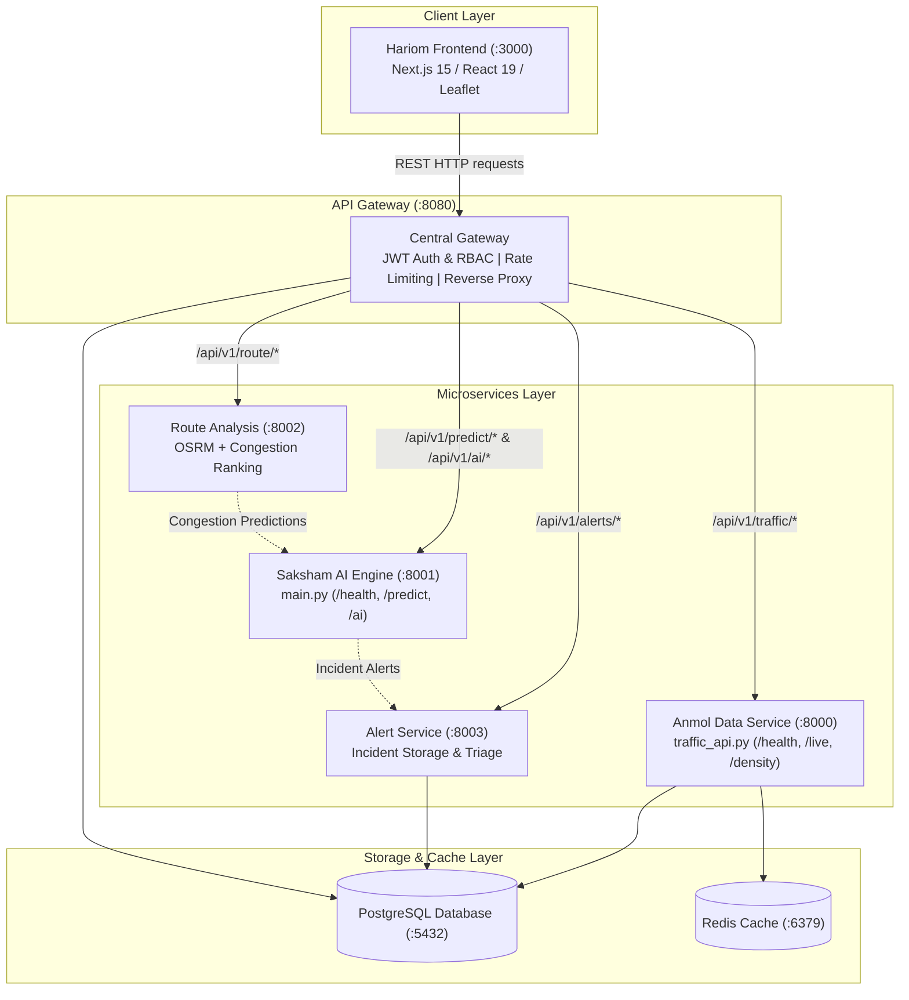

# TrafficVision AI — Cross-Service Integration Notes
**Maintained by:** Intern 1 (Team Lead / Backend & Integration)  
**Status:** All Integration Issues Resolved (Milestone 4 Final Deployment & Integration)  

---

## 1. Purpose of this Document
This document tracks all cross-service integrations and resolution status between:
- `aibin-backend` (API Gateway, Route Analysis, Alert Service - Intern 1)
- `anmol-data` (Traffic Monitoring, Sensor Telemetry, Analytics - Intern 2)
- `saksham-aiml` (AI/ML Congestion Inference, Peak-Hour Detection, Anomalies, Recommendations - Intern 3)
- `hariom-frontend` (Next.js Command Dashboard, Live Map, Route Optimization, Alerts UI - Intern 4)

---

## 2. Integration Issues & Resolution Status

### Issue TV-INT-001: Configurable Alert Service URL in AI Engine
* **Target Component:** `saksham-aiml/ai_engine/main.py`
* **Status:** **RESOLVED**
* **Resolution Applied:**
  Updated `saksham-aiml/ai_engine/main.py` to read `ALERT_SERVICE_URL` from the environment with a default fallback to `http://127.0.0.1:8003`:
  ```python
  ALERT_SERVICE_URL = os.getenv("ALERT_SERVICE_URL", "http://127.0.0.1:8003")
  ```
  In `detect_traffic_anomaly`, the alert POST request now targets `f"{ALERT_SERVICE_URL}/api/v1/alerts"` with a resilient `try...except` wrapper to prevent network hiccups from interrupting anomaly detection.

---

### Issue TV-INT-002: Standard `/health` and `/` Probes in AI Engine
* **Target Component:** `saksham-aiml/ai_engine/main.py`
* **Status:** **RESOLVED**
* **Resolution Applied:**
  Added standard container orchestrator health check probes to `saksham-aiml/ai_engine/main.py`:
  ```python
  @app.get("/health", tags=["Health"])
  def health_check():
      return {
          "status": "healthy",
          "service": "ai-engine",
          "model_loaded": model_artifact is not None,
      }

  @app.get("/", tags=["Health"])
  def root_health():
      return health_check()
  ```

---

### Issue TV-INT-003: Database & Cache Connection URI (`DATABASE_URL`, `REDIS_URL`)
* **Target Component:** `anmol-data/Api/traffic_api.py`
* **Status:** **RESOLVED**
* **Resolution Applied:**
  Updated `anmol-data/Api/traffic_api.py` to support cloud connection URI strings (`DATABASE_URL` and `REDIS_URL`) while maintaining full backward compatibility with discrete variables (`DB_HOST`, `DB_PORT`, `DB_NAME`, `DB_USER`, `DB_PASSWORD`, `REDIS_HOST`, `REDIS_PORT`):
  ```python
  DATABASE_URL = os.getenv("DATABASE_URL")
  def get_connection():
      if DATABASE_URL:
          return psycopg.connect(DATABASE_URL)
      return psycopg.connect(**DB_CONFIG)

  REDIS_URL = os.getenv("REDIS_URL")
  if REDIS_URL:
      redis_client = redis.Redis.from_url(REDIS_URL, decode_responses=True, socket_connect_timeout=1, socket_timeout=1)
  else:
      redis_client = redis.Redis(host=os.getenv("REDIS_HOST", "127.0.0.1"), port=int(os.getenv("REDIS_PORT", "6379")), decode_responses=True, socket_connect_timeout=1, socket_timeout=1)
  ```

---

### Issue TV-INT-004: Standard `/health` Probe in Traffic API
* **Target Component:** `anmol-data/Api/traffic_api.py`
* **Status:** **RESOLVED**
* **Resolution Applied:**
  Added `/health` route alias in `anmol-data/Api/traffic_api.py`:
  ```python
  @app.get("/health", tags=["Health"], summary="Health Check Alias")
  def health():
      return root()
  ```

---

### Issue TV-INT-005: Frontend API Gateway Integration (`hariom-frontend`)
* **Target Component:** `hariom-frontend` & `aibin-backend` Gateway
* **Status:** **RESOLVED**
* **Resolution Applied:**
  1. **Gateway Environment Alignment:** Configured `NEXT_PUBLIC_API_URL=http://localhost:8080/api/v1` across `.env.local`, `.env.production`, and `.env.example`.
  2. **Client Fallback & Network Timeout:** In `hariom-frontend/frontend/app/lib/api.ts`, changed the base fallback from port 8000 to port 8080 (`http://localhost:8080/api/v1`), and increased request timeout to 10 seconds to accommodate distributed microservice propagation.
  3. **Role Normalization:** Normalized backend user roles (`traffic_operator`, `city_planner`, `commuter`) to frontend view tiers (`admin`, `operator`, `public`) ensuring seamless dashboard permission gating.
  4. **AI Recommendations Route Mounting:** Mounted `prediction_proxy` under `/api/v1/ai` as well as `/api/v1/predict` in Gateway (`app/main.py`), supporting `/api/v1/ai/recommendations`, `/api/v1/ai/recommendations/{id}/apply`, `/api/v1/ai/recommendations/{id}/dismiss`, and `/api/v1/ai/anomalies`.
  5. **Route Travel Telemetry:** Added `/travel` route alias in `app/gateway/route_proxy.py` and adapted `optimizeRoute` response structures to support both raw and nested route plan formats.
  6. **Alert Resolution Support:** Added `POST /api/v1/alerts/{id}/resolve` route in both API Gateway (`alert_proxy.py`) and Alert Service (`routers/alerts.py`).
  7. **Role-Based Access for Live Dashboard:** Enabled `commuter` and `city_planner` access to `/api/v1/traffic/live` and `/api/v1/traffic/density` while preserving strict administrative security on `/api/v1/traffic/road/{road_id}`.

---

## 3. Verification & Validation Summary

| Test Suite / Tool | Command | Scope | Result |
| :--- | :--- | :--- | :---: |
| **Backend Unit & Integration Suite** | `pytest -v` | Auth, Congestion, Predictions, RBAC, Route Analysis | **27 / 27 PASS (100%)** |
| **Frontend Production Build** | `npm run build` | Next.js 15 Static Generation, Type Checking, Chunks | **12 / 12 Pages Built (100%)** |
| **AI Model Inference Check** | Python Import & Init | `traffic_model_v2.joblib` loading and inference | **PASSED** |
| **Traffic API Health Check** | Python Import & Probe | `Api.traffic_api.health()` | **PASSED (`status: ok`)** |

---

## 4. Architecture Contract Verification


