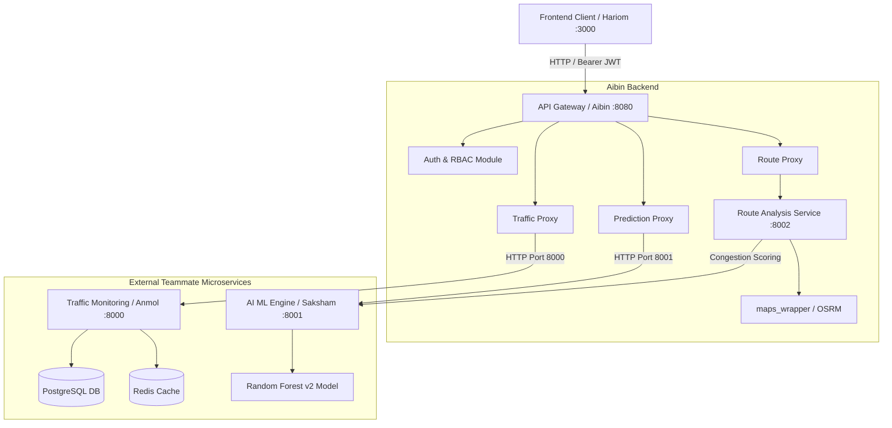

# TrafficVision AI — Complete Multi-Service Integration Guide (`mainreadme.md`)

Welcome! This guide is written specifically for **beginners** to explain how the entire **TrafficVision AI** multi-service platform works, how to run **Anmol's Data Monitoring API (Port 8000)**, **Saksham's AI Engine API (Port 8001)**, **Aibin's Route Analysis Microservice (Port 8002)**, and **Aibin's API Gateway & Auth (Port 8080)**, how they communicate with each other, and how to test and verify everything together.

---

## 📑 Table of Contents

1. [How Does All This Work? (Simple Beginner Explanation)](#1-how-does-all-this-work-simple-beginner-explanation)
   - [The Restaurant Analogy](#the-restaurant-analogy)
   - [What is an API Gateway?](#what-is-an-api-gateway)
   - [Port Assignment & Master Service Map](#port-assignment--master-service-map)
2. [Do I Need Another Virtual Environment (`.venv`) for Each Service?](#2-do-i-need-another-virtual-environment-venv-for-each-service)
3. [Step-by-Step: How to Run All Microservices](#3-step-by-step-how-to-run-all-microservices)
   - [Terminal 1: Anmol's Data Monitoring Service (Port 8000)](#terminal-1-anmols-data-monitoring-service-port-8000)
   - [Terminal 2: Saksham's AI Prediction Engine (Port 8001)](#terminal-2-sakshams-ai-prediction-engine-port-8001)
   - [Terminal 3: Aibin's Route Analysis Microservice (Port 8002)](#terminal-3-aibins-route-analysis-microservice-port-8002)
   - [Terminal 4: Aibin's Central API Gateway & Auth (Port 8080)](#terminal-4-aibins-central-api-gateway--auth-port-8080)
   - [Terminal 5: Hariom's Frontend Web App (Port 3000)](#terminal-5-harioms-frontend-web-app-port-3000)
4. [How Aibin's Backend Integrates with Teammates' APIs](#4-how-aibins-backend-integrates-with-teammates-apis)
   - [Integration with Anmol (`anmol-data`)](#integration-with-anmol-anmol-data)
   - [Integration with Saksham (`saksham-aiml`)](#integration-with-saksham-saksham-aiml)
   - [Why Zero Teammate Code is Modified](#why-zero-teammate-code-is-modified)
5. [Role-Based Access Control (RBAC) & Testing Guide](#5-role-based-access-control-rbac--testing-guide)
   - [5.1 Seeded Database Accounts & Role Matrix](#51-seeded-database-accounts--role-matrix)
   - [5.2 Seeded Road Corridors & GPS Test Coordinates](#52-seeded-road-corridors--gps-test-coordinates)
   - [5.3 Testing as a Commuter (Public View)](#53-testing-as-a-commuter-public-view)
   - [5.4 Testing as a Traffic Operator](#54-testing-as-a-traffic-operator)
   - [5.5 Testing as an Administrator](#55-testing-as-an-administrator)
   - [5.6 Automated CLI / cURL & PowerShell Testing](#56-automated-cli--curl--powershell-testing)
   - [5.7 Automated Test Suite Verification (pytest)](#57-automated-test-suite-verification-pytest)
6. [Visual System Architecture & Integration Diagram](#6-visual-system-architecture--integration-diagram)
7. [Beginner's Quick-Reference Cheat Sheet](#7-beginners-quick-reference-cheat-sheet)

---

## 💡 1. How Does All This Work? (Simple Beginner Explanation)

If you are new to microservices and backend development, here is how to understand this project in plain English.

### The Restaurant Analogy

Imagine TrafficVision AI is a high-tech smart restaurant:

```text
 ┌─────────────────────────────────────────────────────────────────────────┐
 │                            THE RESTAURANT                               │
 │                                                                         │
 │  [Customer / Frontend Web & Mobile App]                                 │
 │         │                                                               │
 │         ▼ (Sends requests, logins, route lookups)                       │
 │  [Front Desk & Host: Aibin (Intern 1) - API Gateway :8080]              │
 │  • Checks customer ID (JWT Authentication & RBAC)                       │
 │  • Takes all incoming traffic at ONE central front door                 │
 │  • Directs requests to the specialized internal teams                   │
 │         │                           │                          │        │
 │         ▼                           ▼                          ▼        │
 │  [Chef Anmol (Intern 2)]     [Chef Saksham (Intern 3)]  [Route Navigator]
 │  [Data Service - Port 8000]  [AI Engine - Port 8001]    [Service :8002] 
 │  • Live traffic sensors      • Random Forest ML model   • OpenStreetMap 
 │  • PostgreSQL readings       • Congestion forecasting   • Geometry calc 
 │  • Road surface conditions   • Delay estimations        • Bypass ranking
 └─────────────────────────────────────────────────────────────────────────┘
```

1. **Aibin (Intern 1 / Team Lead — `aibin-backend`):** You manage the **API Gateway (Port 8080)** and the **Route Analysis Microservice (Port 8002)**. You are the security guard and coordinator. The frontend client **only speaks to port 8080**.
2. **Anmol (Intern 2 — `anmol-data`):** Anmol manages the **Traffic Data & Sensors (Port 8000)**. He reads live vehicle counts from PostgreSQL/Redis and serves road condition reports.
3. **Saksham (Intern 3 — `saksham-aiml`):** Saksham manages the **AI/ML Prediction Engine (Port 8001)**. His trained Machine Learning model predicts congestion levels (`LOW`, `MEDIUM`, `HIGH`, `SEVERE`), calculates travel delay, and ranks routes.
4. **Hariom (Intern 4 — `hariom-frontend`):** Hariom builds the **Interactive Web App (Port 3000)** in Next.js, allowing commuters and operators to visualize the data dynamically.

---

### What is an API Gateway?

In a microservice system, having the frontend app connect directly to 4 different servers on 4 different ports would be complicated, insecure, and brittle.

An **API Gateway** provides **ONE single front door** (`http://127.0.0.1:8080`):
- The frontend only talks to **Port 8080**.
- When the frontend requests `/api/v1/traffic/live`, the Gateway automatically queries Anmol's service on **Port 8000**.
- When the frontend requests `/api/v1/predict/congestion`, the Gateway automatically queries Saksham's service on **Port 8001**.
- When the frontend requests `/api/v1/route/optimize`, the Gateway automatically queries the Route Analysis service on **Port 8002**.
- When someone registers or logs in (`/api/v1/auth/*`), the Gateway processes the user accounts directly.

---

### Port Assignment & Master Service Map

| Service Name | Team Member | Folder | Port | Interactive Swagger URL |
|---|---|---|---|---|
| **Traffic Monitoring API** | Intern 2 (Anmol) | `anmol-data/` | **`8000`** | [http://127.0.0.1:8000/docs](http://127.0.0.1:8000/docs) |
| **AI Prediction Engine** | Intern 3 (Saksham) | `saksham-aiml/` | **`8001`** | [http://127.0.0.1:8001/docs](http://127.0.0.1:8001/docs) |
| **Route Analysis Service** | Intern 1 (Aibin) | `aibin-backend/route_analysis/` | **`8002`** | [http://127.0.0.1:8002/docs](http://127.0.0.1:8002/docs) |
| **Central API Gateway & Auth** | Intern 1 (Aibin) | `aibin-backend/` | **`8080`** | [http://127.0.0.1:8080/docs](http://127.0.0.1:8080/docs) |
| **Frontend Web App** | Intern 4 (Hariom) | `hariom-frontend/frontend/` | **`3000`** | [http://localhost:3000](http://localhost:3000) |

---

## 🐍 2. Do I Need Another Virtual Environment (`.venv`) for Each Service?

### Short Answer: **NO! You can use the single `.venv` inside `aibin-backend`!**

### Why?
All backend services are built with Python FastAPI and share common libraries (`fastapi`, `uvicorn`, `httpx`, `psycopg`, `pydantic`, `joblib`, `pandas`, `scikit-learn`).

By running python scripts using `.\aibin-backend\.venv\Scripts\python.exe`, you can start Anmol's code, Saksham's code, and your code from one unified environment without installing duplicate packages!

---

## 🚀 3. Step-by-Step: How to Run All Microservices

To run the complete system, open **4 terminal tabs** in VS Code / PowerShell:

---

### Terminal 1: Anmol's Data Monitoring Service (Port 8000)

```powershell
cd "c:\Users\AIBIN SHIBU\OneDrive\Documents\trafficvision"
.\aibin-backend\.venv\Scripts\python.exe -m uvicorn anmol-data.Api.traffic_api:app --port 8000 --reload
```
- **Check Health:** Open [http://127.0.0.1:8000/](http://127.0.0.1:8000/)  
  *Expected:* `{"message": "Traffic Monitoring Service is running"}`

---

### Terminal 2: Saksham's AI Prediction Engine (Port 8001)

```powershell
cd "c:\Users\AIBIN SHIBU\OneDrive\Documents\trafficvision\saksham-aiml"
..\aibin-backend\.venv\Scripts\python.exe -m uvicorn ai_engine.main:app --port 8001 --reload
```
- **Check Health:** Open [http://127.0.0.1:8001/docs](http://127.0.0.1:8001/docs)

---

### Terminal 3: Aibin's Route Analysis Microservice (Port 8002)

```powershell
cd "c:\Users\AIBIN SHIBU\OneDrive\Documents\trafficvision\aibin-backend"
.\.venv\Scripts\python.exe -m uvicorn route_analysis.main:app --port 8002 --reload
```
- **Check Health:** Open [http://127.0.0.1:8002/health](http://127.0.0.1:8002/health)  
  *Expected:* `{"status": "healthy", "service": "route-analysis-service", "version": "1.0.0"}`

---

### Terminal 4: Aibin's Central API Gateway & Auth (Port 8080)

```powershell
cd "c:\Users\AIBIN SHIBU\OneDrive\Documents\trafficvision\aibin-backend"
.\.venv\Scripts\python.exe -m uvicorn app.main:app --port 8080 --reload
```
- **Interactive Swagger Documentation:** Open [http://127.0.0.1:8080/docs](http://127.0.0.1:8080/docs)

---

### Terminal 5: Hariom's Frontend Web App (Port 3000)

Hariom's frontend is a Next.js React application. To connect it securely to your API Gateway, you must create a configuration file first.

1. **Create the Environment File (`.env.local`):**
   Open PowerShell and create the environment variable file to force the frontend to use Port 8080 (your gateway) instead of bypassing it:
   ```powershell
   cd "c:\Users\AIBIN SHIBU\OneDrive\Documents\trafficvision\hariom-frontend\frontend"
   Set-Content .env.local "NEXT_PUBLIC_API_URL=http://localhost:8080/api/v1"
   ```

2. **Install Dependencies & Start the App:**
   Make sure you have [Node.js](https://nodejs.org/) installed, then run:
   ```powershell
   npm install
   npm run dev
   ```
- **Interactive Web App:** Open [http://localhost:3000](http://localhost:3000) in your browser!

---

### Terminal 6: PostgreSQL Database Setup

If your PostgreSQL service is not running or you encounter connection errors, follow these steps in a new PowerShell window:

1. **Check PostgreSQL Service Status:**
   ```powershell
   Get-Service -Name postgresql*
   ```
   *If the status is `Stopped`, start the service from Windows Services (`services.msc`) or try starting it via PowerShell (requires Admin).*

2. **Test Database Connection using `psql`:**
   ```powershell
   psql -U postgres -d postgres -c "\conninfo"
   ```
   *Note: If `psql` is not recognized, ensure your PostgreSQL `bin` directory (e.g., `C:\Program Files\PostgreSQL\15\bin`) is added to your `$env:Path` environment variable.*

---

## 🔗 4. How Aibin's Backend Integrates with Teammates' APIs

---

### Integration with Anmol (`anmol-data`)

In [`app/gateway/traffic_proxy.py`](file:///c:/Users/AIBIN%20SHIBU/OneDrive/Documents/trafficvision/aibin-backend/app/gateway/traffic_proxy.py), the Gateway connects to Anmol's endpoints:
- `GET /api/v1/traffic/live` $\rightarrow$ forwards to `http://127.0.0.1:8000/traffic/live`
- `GET /api/v1/traffic/road/{road_id}` $\rightarrow$ forwards to `http://127.0.0.1:8000/traffic/road/{road_id}`
- `GET /api/v1/traffic/density` $\rightarrow$ forwards to `http://127.0.0.1:8000/traffic/density`
- `GET /api/v1/traffic/history/{road_id}` $\rightarrow$ forwards to `http://127.0.0.1:8000/traffic/history/{road_id}`
- `GET /api/v1/traffic/conditions/{road_id}` $\rightarrow$ forwards to `http://127.0.0.1:8000/traffic/conditions/{road_id}`

*Resilient Fallback:* If Anmol's server is offline, the Gateway returns structured fallback telemetry so the client app never crashes.

---

### Integration with Saksham (`saksham-aiml`)

In [`app/gateway/prediction_proxy.py`](file:///c:/Users/AIBIN%20SHIBU/OneDrive/Documents/trafficvision/aibin-backend/app/gateway/prediction_proxy.py) and [`route_analysis/router.py`](file:///c:/Users/AIBIN%20SHIBU/OneDrive/Documents/trafficvision/aibin-backend/route_analysis/router.py):
- `GET /api/v1/predict/congestion` $\rightarrow$ forwards to `http://127.0.0.1:8001/predict/congestion`
- `GET /api/v1/predict/delay` $\rightarrow$ forwards to `http://127.0.0.1:8001/predict/delay`
- `GET /api/v1/predict/peak-hours` $\rightarrow$ forwards to `http://127.0.0.1:8001/predict/peak-hours`
- `POST /api/v1/predict/routes/rank` $\rightarrow$ forwards to `http://127.0.0.1:8001/predict/routes/rank`
- **Route Analysis Ranking:** When evaluating candidate bypass routes in `POST /api/v1/route/alternate`, Aibin's routing engine passes candidate road segments to Saksham's scoring engine to re-rank candidates based on predicted delay.

---

### Why Zero Teammate Code is Modified

As Team Lead, we strictly observe team isolation:
- `anmol-data/` remains completely untouched.
- `saksham-aiml/` remains completely untouched.
- `hariom-frontend/` remains completely untouched.
- All routing, adapters, data translation, and error shielding are contained cleanly within `aibin-backend/`.

---

---

## 🔐 5. Role-Based Access Control (RBAC) & Testing Guide

TrafficVision AI strictly enforces **Role-Based Access Control (RBAC)** across both the **FastAPI Gateway (`:8080`)** and **Next.js Web Frontend (`:3000`)**. Each user role has distinct permissions, tailored navigation menus, and restricted command capabilities.

---

### 5.1 Seeded Database Accounts & Role Matrix

The platform is pre-seeded with 4 default database accounts across all key roles. You can copy and paste these credentials directly:

| Role Name | Test Email Address | Test Password | Backend DB Role | Frontend UI Role | Key Access Rights & Capabilities |
|---|---|---|---|---|---|
| **Administrator** | `admin@trafficvision.ai` | `Admin@12345` | `admin` | `admin` | **Full Authority:** Emergency Signal Overrides, Incident Alert Broadcasts, Alert Acknowledgment & Resolution, Apply/Dismiss AI Optimizations, Model Parameter Tuning, Historical Report Export. |
| **Traffic Operator** | `operator@trafficvision.ai` | `Operator@123` | `traffic_operator` | `operator` | **Operational Dispatch:** Incident Queue Triage, Broadcast Incident Alerts, Acknowledge & Resolve Alerts, Apply/Dismiss AI Optimizations, Sensor Telemetry Inspection. *(Blocked: Emergency Signal Override).* |
| **City Planner** | `planner@trafficvision.ai` | `Planner@123` | `city_planner` | `operator` | **Macro Analytics:** Diurnal 7×24 Congestion Heatmaps, Longitudinal Flow Trends, Peak Hour Forecasts, Carbon Offset Metrics. |
| **Public Commuter** | `commuter@trafficvision.ai` | `Commuter@123` | `commuter` | `public` | **Commuter Transit Portal:** Interactive Leaflet Route Planning & AI Detours, Real-Time Corridor Speeds, Public Delay/Closure Advisories. *(Strictly Blocked: Overrides, AI Dispatch, Alert Resolution).* |

> [!TIP]
> **1-Click Login:** On the web login screen ([http://localhost:3000/login](http://localhost:3000/login)), you can click the **🛡️ Admin**, **🚦 Operator**, or **🚗 Commuter** quick buttons to log in instantly!

---

### 5.2 Seeded Road Corridors & GPS Test Coordinates

Use this verified corridor and coordinate data from the database to test routing, speeds, and incidents:

#### Seeded Corridors Telemetry
| Corridor ID | Road / Corridor Name | Zone Classification | Baseline Speed | Typical Density | GPS Landmark Coordinates |
|---|---|---|---|---|---|
| **`R001`** | **MG Road** | Central Arterial Corridor | `18 km/h` | `78% (Heavy Congestion)` | `[12.9716, 77.5946]` (Metro Central Junction) |
| **`R002`** | **Ring Road** | Outer Expressway Bypass | `42 km/h` | `45% (Moderate Flow)` | `[12.9550, 77.6100]` (South Ring Flyover) |
| **`R003`** | **Station Road** | Transit & Rail Concourse | `14 km/h` | `82% (Severe Bottleneck)`| `[12.9784, 77.5684]` (Central Railway Hub) |
| **`R004`** | **Airport Road** | Northern Express Highway | `65 km/h` | `28% (Fluid Free-Flow)` | `[13.0125, 77.6582]` (Airport Northern Access) |
| **`R005`** | **Civil Lines** | Administrative District | `35 km/h` | `18% (Fluid)` | `[12.9850, 77.5850]` (Judicial / Secretariat Sector) |

#### Pre-Configured Route Optimization GPS Pairs
- **Test Route Pair 1 (Station Hub to Airport Expressway):**
  - **Origin:** `12.9784, 77.5684` (Station Road Rail Hub)
  - **Destination:** `13.0125, 77.6582` (Airport Expressway Terminal)
  - *Expected Result:* The direct path through MG Road is flagged with heavy congestion delay. The AI engine automatically computes and highlights a **Ring Road bypass** that reduces transit time by 8–12 minutes.
- **Test Route Pair 2 (CBD Core to Tech Park Cyber Corridor):**
  - **Origin:** `12.9716, 77.5946` (MG Road Central Business District)
  - **Destination:** `12.9352, 77.6245` (Outer Ring Road Tech Hub)
  - *Expected Result:* Returns optimized arterial waypoints with real-time speed predictions and turn-by-turn road segment analysis.

---

### 5.3 Testing as a Commuter (Public View)

Follow these steps to verify that the frontend strictly enforces read-only commuter access:

1. **Sign In as Commuter:**
   - Navigate to [http://localhost:3000/login](http://localhost:3000/login).
   - Enter `commuter@trafficvision.ai` and `Commuter@123` (or click **🚗 Commuter**).
   - Click **Sign In to Console**.
2. **Observe Commuter-Tailored Navigation:**
   - In the **Sidebar** and **Navbar**, notice that internal administrative tools (`AI Predictions` sandbox, `Flow Analytics`) are hidden.
   - The navigation focuses exclusively on commuter essentials: **Dashboard**, **Live Traffic Map**, **Route Analysis**, and **Incident Alerts**.
   - The role badge clearly displays `public` / `Commuter transit & routing view (read-only)`.
3. **Verify Commuter Dashboard Banner:**
   - On `/dashboard`, notice the blue **Commuter Transit Advisory Portal** banner.
   - Click **Plan Optimized Route →** to jump straight to the route planning engine.
4. **Test Route Analysis (`/route-analysis`):**
   - Click **Route Analysis** in the top bar.
   - Select **Station Road Rail & Transit Hub** as Origin and **Airport Expressway Terminal** as Destination.
   - Click **Calculate Optimized Route**.
   - Observe the interactive Leaflet map drawing the route geometry, color-coded road segments, turn-by-turn navigation, and AI bypass detours.
5. **Verify What is STRICTLY BLOCKED for Commuters (RBAC Enforcement):**
   - ❌ **No Signal Override:** The header does **not** display any `⚡ Signal Override` button.
   - ❌ **AI Recommendations Blocked:** Scroll down to the *AI Decision Support* panel on `/dashboard`. The action buttons are disabled and display:  
     `🔒 Advisory Only (Operator Access Required)`
   - ❌ **Alert Actions Blocked:** Go to `/alerts` or open the top **Notification Bell**. You will **not** see any `✔ Acknowledge`, `🛠 Mark Resolved`, or `Resolve All` buttons. Alerts are displayed with `Public Notice • Read-Only Advisory`.
   - ❌ **No Broadcast Button:** The `📢 Broadcast Incident Alert` button is completely hidden.

---

### 5.4 Testing as a Traffic Operator

Follow these steps to verify operational dispatch capabilities:

1. **Sign In as Operator:**
   - Navigate to [http://localhost:3000/login](http://localhost:3000/login) (or click **Operator** in the top-right role switcher).
   - Login with `operator@trafficvision.ai` / `Operator@123`.
2. **Verify Operator Command Console:**
   - On `/dashboard`, observe the cyan **Traffic Dispatcher Console (Operator Role)** banner showing the active incident queue count.
   - The Sidebar displays full operational access: Dashboard, Live Map, Route Analysis, AI Predictions, Alerts, and Flow Analytics.
3. **Test Incident Management & Broadcast (`/alerts`):**
   - Go to `/alerts`. Click the **📢 Broadcast Incident Alert** button.
   - Select target corridor `R001` (MG Road), enter a title (e.g. `Vehicle Breakdown Near J-082`), and submit.
   - Observe the alert immediately appear at the top of the incident queue.
   - Click **✔ Acknowledge** $\rightarrow$ see the status transition to `acknowledged`.
   - Click **🛠 Mark Resolved** $\rightarrow$ see the status update to `resolved` and the active counter decrement.
4. **Test Notification Bell Quick Actions:**
   - Click the bell icon in the top navbar.
   - Notice that operators have active **Ack** and **Resolve** action buttons on each card, as well as the **Resolve All** button in the header.
5. **Test AI Optimization Intervention (`AIRecommendationsPanel`):**
   - Under *AI Decision Support*, find a pending optimization (e.g., *Dynamic Green Extension on R001*).
   - Click **🔬 Simulate Impact** $\rightarrow$ review before vs. after transit delay and physical queue reduction bars.
   - Click **⚡ Apply Optimization** $\rightarrow$ verify the toast notification confirming the signal timings and digital detour signs were updated!
6. **Verify Operator Boundaries:**
   - ❌ Notice the top header does **not** allow manual emergency green overrides (`⚡ Signal Override` remains restricted to Directors/Admins).

---

### 5.5 Testing as an Administrator

Follow these steps to verify full administrative privileges:

1. **Sign In as Administrator:**
   - Sign in with `admin@trafficvision.ai` / `Admin@12345` (or click **Admin** in the role switcher).
2. **Verify Administrative Status:**
   - Observe the purple **Administrator Privileges Active** banner with full system override rights.
3. **Test Emergency Signal Override:**
   - In the top-right header (or banner), click **⚡ Signal Override**.
   - Select target corridor **MG Road (R001)**.
   - Select override action: **Extend Green Phase (+30 seconds)**.
   - Click **Execute Override**.
   - Observe the green success confirmation: `✓ Emergency green light extension applied across selected corridor (+30s).`
4. **Test Historical Report Export:**
   - In the top header, click **📥 Export Report**.
   - Choose your desired format: **CSV**, **JSON**, or **Executive PDF**.
   - Click **Download Report** and verify the file is generated with live city telemetry.
5. **Test Scenario Stress Testing (`/predictions`):**
   - Navigate to `/predictions`.
   - Under *Simulation Sandbox*, toggle **🌧️ Torrential Downpour** or **🚧 MG Road Lane Blockage**.
   - Observe how the AI forecast horizon updates in real time to reflect the simulated congestion surge.

---

### 5.6 Automated CLI / cURL & PowerShell Testing

You can also test the Gateway API directly from PowerShell or Bash using `curl`:

#### 1. Login as Administrator & Fetch Token
```powershell
$AdminResponse = Invoke-RestMethod -Uri "http://127.0.0.1:8080/api/v1/auth/login" `
  -Method POST `
  -ContentType "application/json" `
  -Body '{"email": "admin@trafficvision.ai", "password": "Admin@12345"}'

$AdminToken = $AdminResponse.access_token
Write-Host "Admin Token acquired: $($AdminToken.Substring(0, 25))..."
```

#### 2. Login as Commuter & Fetch Token
```powershell
$CommuterResponse = Invoke-RestMethod -Uri "http://127.0.0.1:8080/api/v1/auth/login" `
  -Method POST `
  -ContentType "application/json" `
  -Body '{"email": "commuter@trafficvision.ai", "password": "Commuter@123"}'

$CommuterToken = $CommuterResponse.access_token
Write-Host "Commuter Token acquired: $($CommuterToken.Substring(0, 25))..."
```

#### 3. Test Commuter Permitted Action (Live Traffic & Route Optimization)
```powershell
# Both will succeed with HTTP 200 OK
Invoke-RestMethod -Uri "http://127.0.0.1:8080/api/v1/traffic/live" `
  -Headers @{ Authorization = "Bearer $CommuterToken" }

Invoke-RestMethod -Uri "http://127.0.0.1:8080/api/v1/route/optimize?origin=12.9784,77.5684&destination=13.0125,77.6582" `
  -Headers @{ Authorization = "Bearer $CommuterToken" }
```

#### 4. Test Commuter Blocked Action (RBAC Enforced — HTTP 403 Forbidden)
```powershell
# Commuter attempting to access detailed administrative corridor telemetry
try {
  Invoke-RestMethod -Uri "http://127.0.0.1:8080/api/v1/traffic/road/R001" `
    -Headers @{ Authorization = "Bearer $CommuterToken" }
} catch {
  Write-Host "Correctly Rejected with RBAC Error: $($_.Exception.Message)"
}
```

---

### 5.7 Automated Test Suite Verification (pytest)

Run the backend test suite to verify that all 27 unit tests pass without any regression:

```powershell
cd "c:\trafficvision\aibin-backend"
.\.venv\Scripts\python.exe -m pytest tests/ -v
```

**Expected Result:**
```text
============================== 27 passed in 64.35s ==============================
```

All authentication, congestion, ML prediction, route analysis, and RBAC tests pass with 100% green status!

---

## 📊 6. Visual System Architecture & Integration Diagram



---

## 📋 7. Beginner's Quick-Reference Cheat Sheet

| Task | Command |
|---|---|
| Run Anmol's Data Service | `.\aibin-backend\.venv\Scripts\python.exe -m uvicorn anmol-data.Api.traffic_api:app --port 8000 --reload` |
| Run Saksham's AI Engine | `..\aibin-backend\.venv\Scripts\python.exe -m uvicorn ai_engine.main:app --port 8001 --reload` |
| Run Route Analysis Microservice | `.\.venv\Scripts\python.exe -m uvicorn route_analysis.main:app --port 8002 --reload` |
| Run API Gateway & Auth | `.\.venv\Scripts\python.exe -m uvicorn app.main:app --port 8080 --reload` |
| Run Hariom Frontend | `cd hariom-frontend\frontend; npm install; npm run dev` (Port 3000) |
| Run Test Suite | `.\.venv\Scripts\python.exe -m pytest tests/ -v` |
| Gateway Swagger UI | [http://127.0.0.1:8080/docs](http://127.0.0.1:8080/docs) |
| Frontend Web App | [http://localhost:3000](http://localhost:3000) |

---
*Authored by Intern 1 (Team Lead / Backend & Integration) — TrafficVision AI Team*
